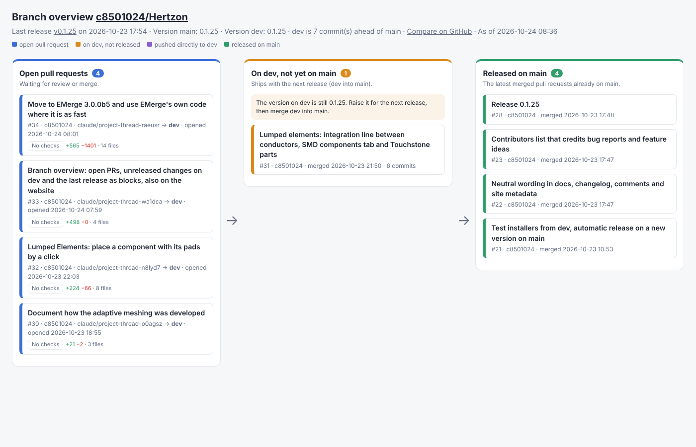

# Release Branch Overview

A GitHub Action (and a small Python script) that shows, as one HTML page with colored blocks, where every
change of a repository stands when pull requests go to a development branch and a release branch holds
the latest release:

**open pull requests → on `dev`, not yet released → released on `main`**



- **Open pull requests**: target branch, draft, check status, merge conflict or behind, lines changed.
- **On dev, not yet on main**: merged pull requests whose merge commit is not on the release branch yet,
  plus commits pushed to the development branch without a pull request.
- **Released on main**: the latest merged pull requests already on the release branch.
- Header: last release, version on both branches (from `pyproject.toml`, `package.json` or `Cargo.toml`),
  link to the compare view. A hint shows when the development branch has unreleased changes but still the
  same version, and when the release branch has commits the development branch lacks (a hotfix).

Branch names are inputs (`base`, `head`), e.g. `main` and `develop`. A repository without a development
branch (pull requests go straight to `main`) gets two lanes: open pull requests and merged ones.

Python standard library only, no dependencies. English and German.

## Publish it on GitHub Pages

Add `.github/workflows/branch-overview.yml` to your repository and set **Settings → Pages → Source** to
**GitHub Actions** once:

```yaml
name: Branch overview

on:
  push:
    branches: [main, dev]
  pull_request_target:            # runs no code of the pull request, only reads the API
    types: [opened, reopened, closed, synchronize, ready_for_review, converted_to_draft, edited]
  schedule:
    - cron: "17 * * * *"          # hourly, picks up check results
  workflow_dispatch:

permissions:
  contents: read
  pull-requests: read
  checks: read
  pages: write
  id-token: write

concurrency:
  group: pages
  cancel-in-progress: true

jobs:
  deploy:
    runs-on: ubuntu-latest
    environment:
      name: github-pages
      url: ${{ steps.deployment.outputs.page_url }}
    steps:
      - uses: c8501024/branch-overview-action@v1
        with:
          base: main
          head: dev
          output: _site/index.html
      - uses: actions/upload-pages-artifact@v3
        with:
          path: _site
      - id: deployment
        uses: actions/deploy-pages@v4
```

If the `github-pages` environment only allows deployments from `main` (the default), runs started by a
push to `dev` or by a pull request are refused. Then keep only `schedule` and `workflow_dispatch` in this
workflow, and start it from a second small workflow on the other events:

```yaml
on:
  push:
    branches: [dev]
  pull_request_target:
    types: [opened, reopened, closed, synchronize, ready_for_review, converted_to_draft, edited]
permissions:
  actions: write
jobs:
  refresh:
    runs-on: ubuntu-latest
    steps:
      - run: gh workflow run branch-overview.yml --ref main --repo "$GITHUB_REPOSITORY"
        env:
          GH_TOKEN: ${{ github.token }}
```

If your repository already publishes a website, build the overview into a subfolder of it instead, e.g.
`output: _site/branches/index.html` before the upload step.

Without Pages, upload the page as a run artifact:

```yaml
      - uses: c8501024/branch-overview-action@v1
      - uses: actions/upload-artifact@v4
        with:
          name: branch-overview
          path: branch-overview/
```

## Inputs

| Input | Default | |
|---|---|---|
| `base` | `main` | release branch |
| `head` | `dev` | development branch; if it does not exist, pull requests into `base` are shown |
| `output` | `branch-overview/index.html` | HTML file to write |
| `lang` | `en` | `en` or `de` |
| `title` | Branch overview owner/name | page heading |
| `released` | `8` | released pull requests shown |
| `version-file` | auto | file with the version; `none` hides versions |
| `noindex` | `false` | ask search engines not to index the page |
| `timezone` | `UTC` | time zone of the dates, e.g. `Europe/Berlin` |
| `repository` | this repository | owner/name |
| `token` | `github.token` | read access to contents, pull requests and checks |

Output `page`: path of the written file.

Costs: GitHub Actions and Pages are free for public repositories. For private repositories the run
minutes count against the plan's included minutes (a run takes a few seconds), and a Pages site of a
private repository is visible to everyone unless the plan supports private Pages.

## Run it locally

```
python branch_overview.py --repo owner/name                 # opens the page in the browser
python branch_overview.py --repo owner/name --serve         # local server, each reload fetches fresh data
python branch_overview.py --base main --head develop --lang de --out overview.html --no-open
```

Inside a clone, `--repo` defaults to the `origin` remote. A token is taken from `GITHUB_TOKEN` / `GH_TOKEN`
or `gh auth token`; public repositories work without one (60 API requests per hour).

## License

MIT
